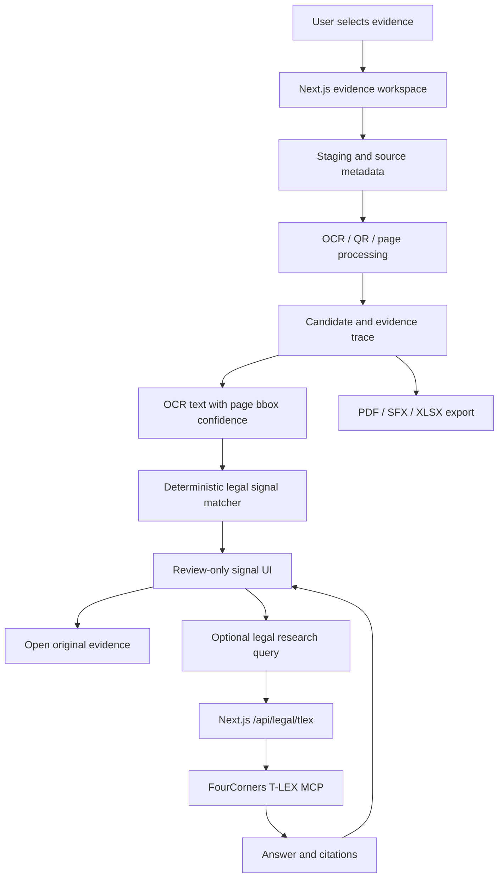

# Digital Evi - Codex: System Flow

## Scope and Source of Truth

The active application root is `D:\Project\Digital Evi - Codex`. The nested `digital-evidence/` directory is a legacy or alternate checkout unless a task explicitly selects it.

This is an evidence triage tool. It extracts searchable facts and possible legal signals from digital evidence while preserving source linkage and requiring human review. It is not an autonomous legal decision system.

## End-to-End Data Flow

1. **Evidence intake**: The user selects chat images, slips, or document pages. The app stages files and retains metadata. Original files remain unchanged.
2. **Image/document processing**: Selected evidence becomes processable pages or image surfaces. OCR and QR extraction run through local utilities and API routes. Crops are derived artifacts only.
3. **OCR/QR trace**: OCR output is associated with source file/page and, where available, bounding box and confidence. Missing or conflicting fields remain reviewable.
4. **Candidate and review state**: Extracted values flow into candidate/ledger views in `src/app/page.tsx`. User edits and raw OCR conflict remain conceptually separate.
5. **Legal signal scan**: OCR text is passed to `matchLegalSignalsInText` in `src/utils/legal-signal-matcher.mjs`, using the existing `src/data/legal_signal_dictionary.json` plus the imported RAW snapshot `src/data/raw_thai_law_master_reference.json` through `src/utils/raw-legal-signal-adapter.mjs`.
6. **Human review UI**: The UI shows matched text, page, file, bbox, confidence and a link back to original evidence. Every hit is `human_review_required` and `legalDecision: false`.
7. **Optional legal research**: A user action sends a bounded query to `/api/legal/tlex`, which calls FourCorners T-LEX with the server-side `FourCorner` key and returns answer/citations as research material.
8. **Export and audit**: PDF/SFX/XLSX are downstream workflows requiring separate E2E verification. Exports must preserve source page, hash/provenance, review state, and distinctions between OCR, user edit, signal, and research.

## System Interaction Map



## Evidence Labels

- **VERIFIED**: Root source declaration, local matcher, API route, browser signal linkage and source-open action were observed.
- **VERIFIED**: RAW trigger phrases were matched in code with `sourceKind`, source version/status and review-only flags.
- **VERIFIED**: TypeScript, targeted lint and targeted Node tests passed in the recorded development run.
- **INFERRED**: The broader OCR/QR pipeline can provide all requested fields across all bank layouts; the snapshot lacks enough labeled dataset evidence to establish this.
- **UNKNOWN**: Production deployment, authentication/access control, retention policy and complete export integrity.
- **UNKNOWN**: Whether every external MCP citation format remains stable outside the observed response.
- **NOT_FOUND**: No evidence that a signal hit establishes guilt or liability; the design explicitly forbids that interpretation.

## Business Logic Constraints

1. A legal signal is a review lead, never a legal conclusion.
2. No signal is not evidence of no wrongdoing.
3. A signal is not evidence that wrongdoing occurred.
4. Raw OCR, derived OCR, user-edited values, review state and legal research remain distinguishable.
5. Source evidence is immutable from the application's perspective.
6. Extracted fields retain page/occurrence/provenance when available.
7. Duplicate candidates are separated from distinct transactions.
8. Unclear OCR/QR data remains pending review; the system must not guess.
9. External research retains citations, request trace, timestamp and failure/quota state.
10. Human review is required before use as an evidentiary or legal conclusion.
11. RAW legal references are a second traceable review source, not an automatic replacement for current official text or FourCorners research.

## Operational Resume

```powershell
cd 'D:\Project\Digital Evi - Codex'
npm run dev -- --port 3450
```

Open `http://127.0.0.1:3450/` and check `PROJECT_STATUS.md` before treating any integration as complete.
